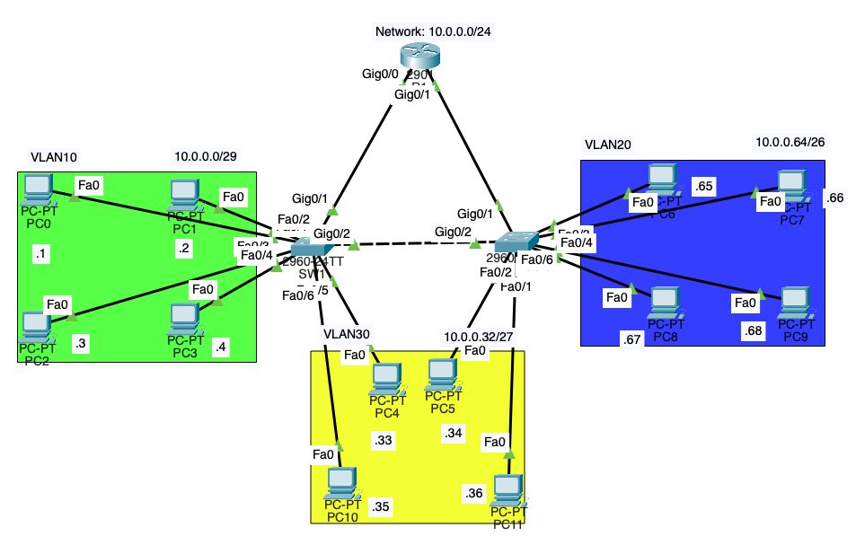
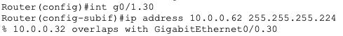

# 01-vlan-roas-vlsm-stp-troubleshooting

## 1. Project Overview
This project demonstrates a small enterprise network built in Cisco Packet Tracer. The network consists of:
1. Router x 1
2. Switches x 2
3. PC x 12

**The objectives were to:**
- Configure VLANs and access ports.
- Implement inter-VLAN routing using Router-on-a-Stick.
- Allocate IP addresses using Variable Length Subnet Masking (VLSM).
- Troubleshoot connectivity issues using ping, Packet Tracer Simulation Mode, and Cisco IOS commands.
- Investigate Spanning Tree Protocol (STP) behavior when extending a VLAN across multiple switches.

## 2. Network Topology

## 3. Network Addressing
| VLAN        |     Subnet         |    Default Gateway    |
| :---        |     :---           |    ---:               |
| VLAN 10     |     10.0.0.0/29    |    10.0.0.6           |
| VLAN 30     |     10.0.0.32/27   |    10.0.0.62          |
| VLAN 20     |     10.0.0.64/26   |    10.0.0.126         |

The router uses subinterfaces to provide default gateways for the VLANs.

- G0/0.10 - VLAN 10
- G0/0.30 - VLAN 30
- G0/0.20 - VLAN 20

## 4. Troubleshooting and Findings

### Problem 1: Incorrect subnet boundary

**Issue:**

I initially assigned IP addresses in the **10.0.0.8 - 10.0.0.12** range to PCs in VLAN 30. My assumption was that because the first subnet (10.0.0.0/29) ended at 10.0.0.7, the next subnet could start at 10.0.0.8 with a /27 prefix.

When testing connectivity, I received a "Destination Host Unreachable" message.

**Investigation:**

I reviewed the subnet mask and learned that a /27 has a block size of 32 addresses. Therefore, valid network boundaries are:

**0, 32, 64, 96, 128, 160, 192, 224**

Although .8 is the next available address after the first /29, it is not a valid /27 network boundary. The address 10.0.0.8/27 belongs to the 10.0.0.0/27 network, which overlaps with the existing 10.0.0.0/29 subnet.

**Resolution:**

I reassigned VLAN 30 to 10.0.0.32/27.

This subnet provides:
- Network address: 10.0.0.32
- Usable host range: 10.0.0.33 - 10.0.0.62
- Broadcast address: 10.0.0.63
- Default gateway: 10.0.0.62

This corrected the addressing plan and avoided overlapping subnets.

### Problem 2: Extending VLAN 30 across 2 switches

**Issue:**

R1 connects to SW1 through g0/0 and to SW2 through g0/1. I configured Router-on-a-Stick subinterfaces for VLAN 10, VLAN 30, and VLAN 20.
I attempted to configure g0/1.30 with the same IP address as g0/0.30 (10.0.0.62/27), but IOS rejected the configuration because the IP address and subnet overlapped with the existing subinterface.

**Investigation:**

I learned that creating another router subinterface does not extend an existing VLAN across multiple switches, and then assigning the same IP address and subnet to both router subinterfaces is not a valid solution.

**Resolution:**

I retained g0/0.30 as the default gateway for VLAN 30, and removed the g0/1.30 subinterface. Then, I used a crossover cable to connect SW1 and SW2, and then ran **switchport mode trunk** to their g0/2 interfaces.

### Problem 3: Investigating STP port roles

After establishing the trunk link between SW1 and SW2, I ran the command **show spanning-tree* to investigate STP behavior.

For VLAN 30, I observed:
- SW1 G0/2: **Root Port**
- SW2 G0/2: **Designated Port**
- SW2's Root ID and Bridge ID matched.

**Findings:**
The matching Root ID and Bridge ID on SW2 indicated that SW2 was the root bridge for VLAN 30. Both ports could remain in **Forwarding** state because a single trunk link between switches did not create a redundant Layer 2 path by itself.

## 5. Key Learnings:
- **VLSM**: Subnet boundaries must align with the block size determined by the prefix length.
- **Router-on-a-Stick**: Router subinterfaces provide Layer 3 gateways for VLANs, but do not extend VLANs between switches
- **Troubleshooting**: Ping tests, Packet Tracer Simulation Mode, and commands such as **show spanning-tree** help isolate connectivity issues.