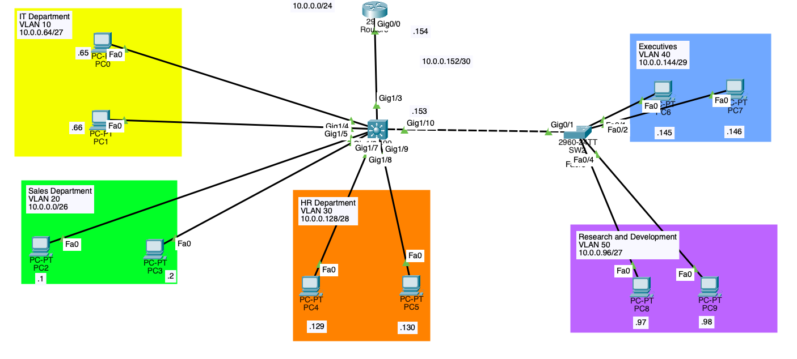
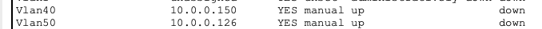

# 02-layer-3-switching

## 1. Project Overview
This project demonstrates a small enterprise network built in Cisco Packet Tracer. The network consists of:
1. Router x 1
2. Layer 2 Switch x 1
3. Layer 3 Switch x 1
4. PC x 10

**The objectives were to:**
- Configure VLANs and access ports.
- Implement inter-VLAN routing using a Layer 3 (Multi-layer) switch.
- Allocate IP addresses using Variable Length Subnet Masking (VLSM).
- Troubleshoot connectivity issues using ping, Packet Tracer Simulation Mode, and Cisco IOS commands.

## 2. Network Topology

## 3. Network Addressing
| VLAN | Subnet | Default Gateway |
| :--- | :--- | ---: |
| VLAN 20 | 10.0.0.0/26 | 10.0.0.62 |
| VLAN 10 | 10.0.0.64/27 | 10.0.0.94 |
| VLAN 50 | 10.0.0.96/27 | 10.0.0.126 |
| VLAN 30 | 10.0.0.128/28 | 10.0.0.142 |
| VLAN 40 | 10.0.0.144/29 | 10.0.0.150 |
| -       | 10.0.0.152/30 | - |

SW1 and R1 are connected via routed ports.
SW1's G1/3 - 10.0.0.153
R1's G0/0 - 10.0.0.152

## 4. Troubleshooting and Findings

### Problem 1: Incorrect port setting

**Issue:**
- PC6 (10.0.0.145) from VLAN 40 is unable to ping PC8 (10.0.0.97) from VLAN 50
- But PC6 (10.0.0.145) from VLAN 40 is able to ping PC7 (10.0.0.146) in the same VLAN

**Investigation:**

1. I navigated to SW2's cli and ran: **do show interface trunk** and confirmed that G0/1 is enabled, and allowing VLANs 1, 40, and 50
2. I navigated to SW1's cli and ran: **do show ip interface brief** and found the following:

| Interface | Status | Protocol |
| :--- | :--- | :--- |
| VLAN 40 | Up | Down |
| VLAN 50 | Up | Down |

I remember running the command: **no switchport** in the interface: G1/10 which is connected to SW2's G0/2 and both should be trunk ports. To confirm the setting, I ran **do show running-config** and I confirmed that **no switchport** has been activated.

**Resolution:**

I ran the command: **switchport** and this converted it from a routing port back to a switchport. Then, the affected interfaces now showed up/up state. Also confirmed that PCs can now ping each other.

## 5. Key Learnings:
- Re-learned that connecting Layer 3 Switch to a Layer 2 Switch does not require converting the port to a routed port.
- However, it is common that connection between Layer 3 Switch and router is via routed ports. Thus, you will need to allocate IP addresses for both interfaces. 