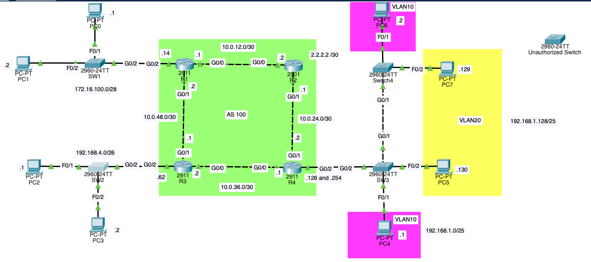
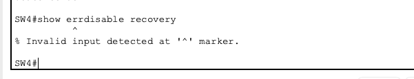
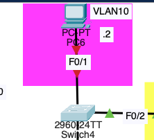
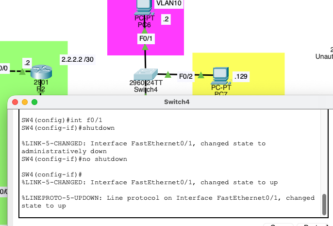
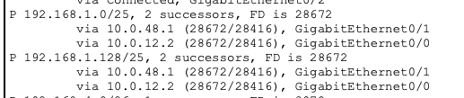
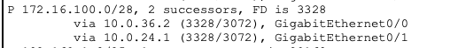

# 03-eigrp-rstp

## 1. Project Overview
This project demonstrates 3 small enterprise networks separated by routers. This lab consists of:
1. Router x 4
2. Switch x 5
3. PC x 8

**The objectives were to:**
- Configure VLANs and access port
- Implement inter-VLAN routing
- Implement Rapid-PSVT+
- Allow access ports to go up/up state when connected to end hosts using portfast
- Disable access ports using BPDU guard if a switch is connected
- Implement Dynamic Routing Protocol = **EIGRP** for different networks to allow communication
- R1 and R4 will load balance the traffic

## 2. Network Topology

## 3. Network Addressing

**Network 172.16.100.0/28**
| PC | IP Address |
| :--- | ---: |
| PC1 | 172.16.100.1 |
| PC2 | 172.16.100.2 |
| R1's G0/2 | 172.16.100.14 |

**Network 192.168.4.0/26**
| PC | IP Address |
| :--- | ---: |
| PC2 | 192.168.4.1 |
| PC3 | 192.168.4.2 |
| R3's G0/2 | 192.168.4/62 |

**Network 192.168.1.0/25**
| PC | IP Address | VLAN |
| :--- | ---: | ---: |
| PC4 | 192.168.1.1 | VLAN 10 |
| PC6 | 192.168.1.2 | VLAN 10 |
| PC5 | 192.168.1.130 | VLAN 20 |
| PC7 | 192.168.1.129 | VLAN 20 |
| R4's G0/2.10 | 192.168.1.126 | VLAN 10 |
| R4's G0/2.20 | 192.168.1.254 | VLAN 2 |

**Network 2.2.2.2/30 - R2's Loopback Interface 0**

**Network 10.0.12.0/30**
| Router | Interface | IP Address |
| :--- | :---: | ---:|
| R1 | G0/0 | 10.0.12.1 |
| R2 | G0/0 | 10.0.12.2 |

**Network 10.0.24.0/30**
| Router | Interface | IP Address |
| :--- | :---: | ---:|
| R2 | G0/1 | 10.0.24.1 |
| R4 | G0/1 | 10.0.24.2 |

**Network 10.0.36.0/30**
| Router | Interface | IP Address |
| :--- | :---: | ---:|
| R4 | G0/0 | 10.0.36.1 |
| R3 | G0/0 | 10.0.36.2 |

**Network 10.0.48.0/30**
| Router | Interface | IP Address |
| :--- | :---: | ---:|
| R3 | G0/1 | 10.0.48.1 |
| R1 | G0/1 | 10.0.48.2 |

## 4. Switch and Router Settings

### SW1 and R1
#### SW1's Settings
- spanning-tree mode rapid-pvst
- spanning-tree portfast default
- spanning-tree portfast bpduguard default
- interface FastEthernet0/1 - set as Access port
- interface FastEthernet0/2 - set as Access port
- interface GigabitEthernet0/2 - set as Trunk port

#### R1's Settings
- spanning-tree mode pvst
- interface GigabitEthernet0/0 - ip address 10.0.12.1 255.255.255.252
- interface GigabitEthernet0/1 -  ip address 10.0.48.2 255.255.255.252
- interface GigabitEthernet0/2 -  ip address 172.16.100.14 255.255.255.240
- router eigrp 100
- variance 2
- passive-interface GigabitEthernet0/2
- network 10.0.48.0 0.0.0.3
- network 172.16.100.0 0.0.0.255
- network 10.0.12.0 0.0.0.3

### R2's Settings
- spanning-tree mode pvst
- interface Loopback0 - ip address 2.2.2.2 255.255.255.255
- interface GigabitEthernet0/0 - ip address 10.0.12.2 255.255.255.252
- interface GigabitEthernet0/1 - ip address 10.0.24.1 255.255.255.252
- router eigrp 100
- passive-interface Loopback0
- network 2.2.2.2 0.0.0.0
- network 10.0.12.0 0.0.0.3
- network 10.0.24.0 0.0.0.3

### SW2 and R3
#### SW1's Settings
- spanning-tree mode pvst
- spanning-tree portfast default
- spanning-tree portfast bpduguard default
- interface FastEthernet0/1 - set as Access port
- interface FastEthernet0/2 - set as Access port
- interface GigabitEthernet0/2 - set as Trunk port

#### R3's Settings
- spanning-tree mode pvst
- interface GigabitEthernet0/0 - ip address 10.0.36.2 255.255.255.252
- interface GigabitEthernet0/1 - ip address 10.0.48.1 255.255.255.252
- interface GigabitEthernet0/2 - ip address 192.168.4.62 255.255.255.192
- router eigrp 100
- passive-interface GigabitEthernet0/2
- network 10.0.48.0 0.0.0.3
- network 10.0.36.0 0.0.0.3
- network 192.168.4.0 0.0.0.63

### SW3, S4, and R4
#### SW3's Settings
- spanning-tree mode rapid-pvst
- spanning-tree portfast default
- spanning-tree portfast bpduguard default
- interface FastEthernet0/1 - vlan 10
- interface FastEthernet0/2 - vlan 20
- interface GigabitEthernet0/1 - set as trunk, VLANs 10,20
- interface GigabitEthernet0/2 - set as trunk, VLANs 10,20
- Set as VTP Server, Domain Name: Lab

#### SW4's Settings
- spanning-tree mode pvst
- spanning-tree portfast default
- spanning-tree portfast bpduguard default
- interface FastEthernet0/1 - set as Access port, vlan 10
- interface FastEthernet0/2 - set as Access port, vlan 20
- interface GigabitEthernet0/1 - set as trunk port, VLANs 10,20
- set as VTP client, and automatically joined Domain: Lab

#### R4's Settings
- spanning-tree mode pvst
- interface GigabitEthernet0/0 - ip address 10.0.36.1 255.255.255.252
- interface GigabitEthernet0/1 - ip address 10.0.24.2 255.255.255.252
- interface GigabitEthernet0/2.10:
    1. encapsulation dot1Q 10
    2. ip address 192.168.1.126 255.255.255.128
- interface GigabitEthernet0/2.20
    1. encapsulation dot1Q 20
    2.  ip address 192.168.1.254 255.255.255.128
- router eigrp 100
- variance 2
- passive-interface GigabitEthernet0/2
- network 10.0.36.0 0.0.0.3
- network 10.0.24.0 0.0.0.3
- network 192.168.1.0

## 5. Troubleshooting
- Removed PC6's connection to SW4, and then connected "Unauthorized Switch" to SW4's F0/1 to test BPDU Guard
- Confirmed that F0/1's port was errdisabled
- 
- Tried running: show errdisable recovery but is not working. Upon checking, I confirmed that this command is not available in Packet Tracer
- 
- Connected PC6 back to F0/1 but port is still errdisabled
- 
- I manually ran **shutdown** and **no shutdown** on the interface since command: **errdisable recovery** is not working. Now the port works again.
- 

## 6. Key Learnings
- EIRGP allows the routers to learn the neighbor's routes. Thus, I no longer need to manually add **static routes** like before.
- If **successor route** goes down for some reason, the **feasible successor route** can alternatively be used to route traffic to destination.
- Since **variance 2** was ran on R1 and R4, the load is balanced over 2 routes
- 
- 